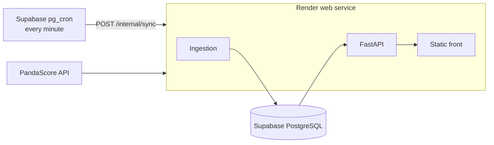

# Architecture

## Components

- **Ingestion** (`backend/ingestion`): pulls running / upcoming / past matches and team rosters, parses them and
  upserts teams, players, matches and games (idempotent). In production a Supabase `pg_cron` job calls
  `POST /internal/sync` every minute; locally it runs as `python -m ingestion.sync [--loop]`.
- **API** (`backend/app`): FastAPI exposing `/matches`, `/matches/{id}`, `/videogames`, `/health`, and serving the
  front at `/`.
- **Front** (`frontend/index.html`): one static file, vanilla JS, polls the API every 30 s.
- **Database**: PostgreSQL on Supabase in production, SQLite locally and in tests. Schema managed by Alembic
  (`backend/migrations`), applied on every start.

## Decisions

- Multi-game by design: `videogame` is a column, not a table per game. Adding a game requires no schema change.
- Upserts instead of inserts: the provider re-sends matches whose status or score changed.
- Free-tier quota (1000 requests/hour): one cycle is 3 requests plus at most 1 batched roster request (100 teams).
- Free hosting: the cron call that triggers ingestion also keeps the free Render instance awake, so no paid worker
  or scheduler is needed. See [deploy.md](deploy.md).
