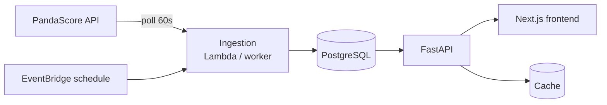

# Architecture

## Components

- **Ingestion** (`backend/ingestion`): pulls running / upcoming / past matches, parses them and upserts teams and matches (idempotent). Runs as a Lambda on a schedule in AWS, or as a loop worker in Docker Compose.
- **API** (`backend/app`): FastAPI exposing `/matches`, `/matches/{id}`, `/videogames`, `/health`.
- **Database**: PostgreSQL in production, SQLite in tests.
- **Infra** (`infra`): Terraform/OpenTofu.

## Decisions

- Multi-game by design: `videogame` is a column, not a table per game. Adding a game requires no schema change.
- Upserts instead of inserts: the provider re-sends matches whose status or score changed.
- Free-tier quota (1000 requests/hour): polling is tiered (live often, schedule rarely) and API responses will be cached.
